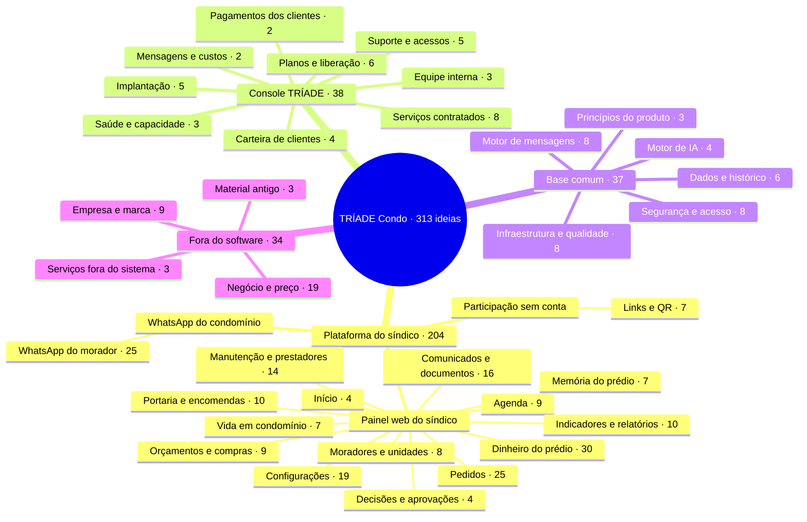

# TRÍADE Condo — mapa do sistema

Onde cada ideia do [`IDEIAS.md`](IDEIAS.md) entra no sistema real: em qual dos dois sistemas, em qual peça e de que forma.
Versão visual e interativa (com busca e filtro por forma): [`mapa.html`](mapa.html) — abra no navegador.

> Este mapa é derivado do `IDEIAS.md`. Ao criar, mover ou renumerar ideias lá, atualize também este mapa e o `mapa.html`.

## Resumo

| Parte | Peças | Ideias |
|---|---|---|
| Plataforma do síndico | 16 | 204 |
| Console TRÍADE | 9 | 38 |
| Base comum | 6 | 37 |
| Fora do software | 4 | 34 |
| **Total** | **35** | **313** |

## Mapa mental

## Índice de códigos

Em que peça está cada ideia. "AT-01 a 04" quer dizer AT-01, AT-02, AT-03 e AT-04.

**Plataforma do síndico**

| Peça | Códigos |
|---|---|
| Início | AT-08; W-11; IA-10; TR-11 |
| Pedidos | AT-01 a 04, 06, 07, 09, 11 a 15, 17, 18, 20, 26, 27, 31 a 33; IA-03, 04, 12, 13, 19 |
| Decisões e aprovações | V-14; AT-23; IA-08; FC-10 |
| Moradores e unidades | MU-01, 02, 06 a 11 |
| Comunicados e documentos | CD-01, 02, 04 a 11, 13 a 15; IA-05 a 07 |
| Manutenção e prestadores | V-13; MP-01 a 07, 09 a 11, 13, 15, 16 |
| Agenda | AG-01 a 09 |
| Orçamentos e compras | OC-01, 02, 04 a 10 |
| Dinheiro do prédio | FC-01 a 03, 05 a 09, 11; DR-01 a 13, 15 a 22 |
| Portaria e encomendas | PA-01 a 05, 07 a 11 |
| Vida em condomínio | AC-01 a 07 |
| Indicadores e relatórios | TR-01 a 05, 07 a 10; IA-14 |
| Memória do prédio | MP-12, 14; CT-02 a 04; IA-09, 17 |
| Configurações | V-04 a 06, 09; AT-05, 10, 25, 29; CF-01 a 08, 10, 12; NG-21 |
| WhatsApp do morador | V-07; W-05 a 10, 12, 16, 19, 21, 22; AT-16, 19, 21, 22, 28; CD-03; IA-01, 02, 18, 20; MU-05; FC-04; DR-14 |
| Links e QR | V-11, 12; AT-30; MP-08; OC-03; PA-06; CD-12 |

**Console TRÍADE**

| Peça | Códigos |
|---|---|
| Carteira de clientes | V-10; PI-01, 02, 06 |
| Implantação | W-01, 03; PI-04, 05; SH-01 |
| Planos e liberação | CF-11; PI-03, 16, 19; NG-01, 06 |
| Pagamentos dos clientes | PI-07, 08 |
| Suporte e acessos | PI-09, 11, 17, 20; CT-01 |
| Serviços contratados | SH-02 a 06, 09, 10; PI-14 |
| Equipe interna | PI-10, 12, 18 |
| Saúde e capacidade | PI-13, 15; TR-06 |
| Mensagens e custos | NG-13, 15 |

**Base comum**

| Peça | Códigos |
|---|---|
| Segurança e acesso | MU-03, 04; PT-01, 02, 06, 08, 11, 13 |
| Dados e histórico | AT-24; CF-09; PT-03, 04, 07, 09 |
| Motor de mensagens | W-02, 04, 13 a 15, 17, 18, 20 |
| Infraestrutura e qualidade | PT-05, 10, 12, 14 a 18 |
| Princípios do produto | V-01, 08, 17 |
| Motor de IA | IA-11, 15, 16, 21 |

**Fora do software**

| Peça | Códigos |
|---|---|
| Serviços fora do sistema | SH-07, 08, 11 |
| Negócio e preço | V-02, 03, 16; NG-02 a 05, 07 a 12, 14, 16 a 20 |
| Empresa e marca | V-15; EM-01 a 08 |
| Material antigo | FI-01 a 03 |

## Como ler as formas

| Forma | O que significa |
|---|---|
| Aba | Área própria dentro do sistema, com lugar fixo no menu |
| Função | Algo que a pessoa faz no sistema |
| Regra | Comportamento que o sistema sempre segue |
| Aviso | Mensagem ou alerta automático |
| Configuração | Ajuste que cada condomínio escolhe |
| Indicador | Número acompanhado ao longo do tempo |
| Integração | Feito junto com um parceiro ou outro serviço |
| Serviço | Trabalho humano da TRÍADE, registrado no sistema |
| Negócio | Decisão comercial ou da empresa, não vira tela |
| Referência | Material antigo guardado para consulta |

---

## Plataforma do síndico

Sistema do condomínio. Inclui o WhatsApp do morador, porque o canal é do condomínio.

### Painel web do síndico

#### Início (4)

O dia do síndico: o que vence hoje, o que espera decisão, o resumo do que aconteceu e os avisos que chegam no WhatsApp dele.

| ID | Ideia | Forma |
|---|---|---|
| IA-10 | Resumo diário para o síndico | Função |
| TR-11 | Início com cartões de agora separados dos de mês fechado; cada cartão abre a lista de onde veio | Função |
| AT-08 | Alerta de retorno vencido | Aviso |
| W-11 | Síndico recebe no WhatsApp: novo pedido, nova reclamação, retorno vencido e novidades relevantes, sem precisar manter… | Aviso |

#### Pedidos (25)

Todo pedido do morador, do registro até a conclusão explicada, com próximo retorno e histórico.

| ID | Ideia | Forma |
|---|---|---|
| AT-02 | Fila de pedidos com filtros por situação, responsável, prioridade e categoria | Aba |
| AT-27 | Kanban de pedidos | Aba |
| AT-01 | Registro do pedido: protocolo, condomínio, unidade, contato, local, categoria, descrição, anexos | Função |
| AT-11 | Pendências e impedimentos explícitos: aguardando fornecedor, morador, decisão do síndico, peça, acesso | Função |
| AT-13 | Conclusão com explicação ao morador e evidência quando fizer sentido (foto, referência), sem exigir foto sempre | Função |
| AT-15 | Reabertura com motivo, preservando a conclusão anterior | Função |
| AT-18 | Relacionar pedidos duplicados e reincidências por local/categoria, mantendo o protocolo e o histórico de cada relato | Função |
| AT-31 | Cancelamento do pedido com motivo e autor; o pedido cancelado continua no histórico | Função |
| AT-33 | Pedido fora do que cabe ao condomínio vira encaminhamento registrado, com resposta ao morador, sem prometer resolver | Função |
| IA-03 | Rascunho de resposta ao morador para o síndico aprovar com um toque | Função |
| IA-04 | Resumo do caso e do histórico para quem assume o pedido | Função |
| IA-12 | Extrair tarefas das conversas, com responsável e prioridade | Função |
| IA-13 | Diagnóstico de problema por foto | Função |
| IA-19 | Classificar o pedido automaticamente a partir da mensagem | Função |
| AT-03 | Responsável real por pedido; quem responde pode ser diferente de quem executa | Regra |
| AT-04 | Prioridades com significado explícito | Regra |
| AT-06 | Próximo retorno: compromisso de atualizar o morador, separado da previsão de solução (padrão "periodic update" de hel… | Regra |
| AT-07 | Previsão de solução só quando conhecida; ausência fica explícita, nunca prazo inventado | Regra |
| AT-12 | Sem executor disponível: pendência real, nunca pessoa inventada | Regra |
| AT-14 | Revisão da conclusão pelo síndico ou revisor antes de encerrar | Regra |
| AT-17 | Histórico completo com autor, data e antes/depois; nada é apagado | Regra |
| AT-20 | Responsabilidade da unidade × condomínio: avisar quando o problema é do morador, com base nas regras do prédio | Regra |
| AT-32 | Pedido privado: reclamação visível só a quem abriu e à gestão autorizada; outros moradores recebem no máximo um resum… | Regra |
| AT-09 | Escalonamento automático: retorno vencido avisa responsável → síndico → substituto ou conselho | Aviso |
| AT-26 | Avisar todos os envolvidos ao mesmo tempo quando um problema é registrado: síndico, prestador, moradores afetados | Aviso |

#### Decisões e aprovações (4)

O que precisa do síndico, do subsíndico ou do conselho para seguir em frente.

| ID | Ideia | Forma |
|---|---|---|
| AT-23 | Solicitação de decisão ao síndico: alternativas, custo estimado, prazo, justificativa da aprovação ou devolução | Função |
| FC-10 | Conselho aprova faturas ou despesas no sistema | Função |
| IA-08 | Assistente jurídico para o síndico com base na lei e na convenção, com aviso de que não substitui advogado (Seu Síndi… | Função |
| V-14 | Conselho e subsíndico como níveis de escalonamento e de aprovação | Regra |

#### Moradores e unidades (8)

Quem mora em cada unidade, os contatos autorizados e as mudanças.

| ID | Ideia | Forma |
|---|---|---|
| MU-01 | Cadastro breve: nome, telefone, apartamento; CPF só se necessário ao financeiro. A unidade fica do jeito que o prédio se organiza: torre, bloco, quadra ou prédio (ou sem divisão), com ou sem andar; vale para morador e para proprietário (condômino); quando a unidade tem inquilino, o proprietário do imóvel fica no cadastro, para controle | Função |
| MU-06 | Família, veículos e pets no cadastro | Função |
| MU-07 | Mudança de morador: entrada e saída com revogação do vínculo | Função |
| MU-08 | Múltiplos contatos autorizados por unidade (titular, cônjuge, inquilino), com preferências e revogação | Função |
| MU-09 | Link de cadastro de morador com validade e campos escolhidos; fila de pendentes para aprovar, corrigir ou recusar | Função |
| MU-10 | Vínculo detalhado: proprietário, responsável e morador, parentesco e período de ocupação | Função |
| MU-11 | Lista de unidades com contadores, etiquetas à venda e à locação, busca por nome, telefone e placa | Função |
| MU-02 | Verificação do vínculo contato ↔ unidade; contato desconhecido não acessa nada restrito | Regra |

#### Comunicados e documentos (16)

Avisos, regimento, convenção, atas e o arquivo do prédio.

| ID | Ideia | Forma |
|---|---|---|
| CD-07 | Arquivo administrativo com versões anteriores e revisões | Aba |
| CD-01 | Comunicado: rascunho → publicado → substituído/arquivado, com autor, data e versão | Função |
| CD-05 | Comunicado ligado a um pedido | Função |
| CD-06 | Campanhas e comunicação programada | Função |
| CD-09 | Avisos com foto | Função |
| CD-13 | Comunicados por e-mail, com e-mail confirmado, link pessoal e "parar de receber" | Função |
| CD-14 | Documento por e-mail quando pedido, por link que expira | Função |
| CD-15 | Mural visto do painel, ao vivo e sem contar abertura; o mural em feed e os classificados em vitrine | Aba |
| IA-05 | Redação de comunicados e avisos | Função |
| IA-06 | Rascunho de ata a partir de anotações de reunião real | Função |
| IA-07 | Resumo de documentos longos: orçamento anual, laudos, contratos | Função |
| CD-02 | Público autorizado: todo o condomínio, torre ou bloco, unidade ou contatos escolhidos (uCondo, MeuVizy) | Regra |
| CD-04 | Arquivos privados com acesso por permissão; nada em pasta pública | Regra |
| CD-11 | Plano de comunicação do condomínio: o que o morador recebe, quando, e sobre o que é consultado | Configuração |
| CD-08 | Acompanhar recebimento dos comunicados quando o canal permitir | Indicador |
| CD-10 | Carta física ou eletrônica para convocação formal | Integração |

#### Manutenção e prestadores (14)

Preventivas, tarefas, vistorias e quem executa cada serviço.

| ID | Ideia | Forma |
|---|---|---|
| MP-01 | Coordenação de manutenção: necessidade, área/equipamento, responsável, executor, prioridade, previsão, próximo retorno | Aba |
| MP-05 | Cadastro de prestadores, mantido quando o síndico muda (Nextin) | Aba |
| MP-02 | Tarefas de manutenção com providência, executor e resultado | Função |
| MP-03 | Manutenção preventiva e corretiva; calendário de preventivas | Função |
| MP-06 | Indicação de prestadores avaliados pelos moradores | Função |
| MP-07 | Vistorias e checklists quando necessários (sem checklist universal), registrando responsável, acesso, impedimentos e… | Função |
| MP-09 | Fornecedor reserva automático quando o principal não responde | Função |
| MP-10 | Agrupar chamados próximos para reduzir deslocamento do prestador | Função |
| MP-11 | Identificar dano causado por morador e cobrar ressarcimento | Função |
| MP-15 | Canal de defeitos construtivos com a construtora, separado da manutenção do condomínio | Função |
| MP-16 | Plano de manutenção de longo prazo com previsão orçamentária | Função |
| V-13 | Construtora/incorporadora como ator: defeitos de obra e canal de venda | Função |
| MP-04 | Vínculo opcional entre manutenção, pedido do morador e agenda | Regra |
| MP-13 | Programa de manutenção alinhado à ABNT NBR 5674 | Regra |

#### Agenda (9)

Reuniões, visitas técnicas e lembretes.

| ID | Ideia | Forma |
|---|---|---|
| AG-03 | Lista cronológica e calendário mensal/semanal | Aba |
| AG-01 | Compromissos: reunião, visita técnica, atividade programada, lembrete administrativo | Função |
| AG-05 | Recorrência simples | Função |
| AG-09 | Agenda que reúne datas de outras telas (feriados, reservas, votações, vencimentos), respeitando a permissão de cada uma | Função |
| AG-02 | Estados: planejado, a confirmar, confirmado, realizado, cancelado; reagendar guarda o anterior | Regra |
| AG-07 | Morador recebe só o que lhe diz respeito (ex.: visita no apartamento dele) | Regra |
| AG-08 | Agenda independente do atendimento: o próximo retorno não depende dela, a previsão de solução não vira evento sozinha… | Regra |
| AG-04 | Aviso de conflito de horário | Aviso |
| AG-06 | Lembretes pelo WhatsApp a quem participa | Aviso |

#### Orçamentos e compras (9)

Cotar, comparar, decidir com justificativa e contratar.

| ID | Ideia | Forma |
|---|---|---|
| OC-01 | Fluxo: necessidade → convite a fornecedores → propostas e anexos → comparação → decisão justificada → aceite → acompa… | Aba |
| OC-02 | Comparar escopo, não só preço: inclusões, exclusões, frete, prazo, validade, garantia | Função |
| OC-07 | Planilha comparativa exportável em PDF para o conselho (CoteiBem) | Função |
| OC-08 | Compra por itens: lista com quantidade e foto, preço por item, marca e frete; dividir itens entre fornecedores | Função |
| OC-09 | Cotação com sugestão de fornecedores da rede, além da cotação direta | Função |
| OC-10 | Contratos com prestadores ligados às cotações | Função |
| OC-04 | Versões de proposta preservadas; cancelamento não apaga | Regra |
| OC-06 | Escolha mais cara exige justificativa | Regra |
| OC-05 | Mínimo de propostas e alçadas configuráveis pelo condomínio, não universais | Configuração |

#### Dinheiro do prédio (30)

Para onde vai a taxa, o que ela trouxe de volta e a prestação de contas.

| ID | Ideia | Forma |
|---|---|---|
| DR-13 | Extrato aberto do condomínio | Aba |
| DR-22 | Relatórios financeiros para os moradores | Aba |
| DR-01 | Recibo do condômino | Função |
| DR-02 | Seu dinheiro em coisas concretas | Função |
| DR-03 | Antes e depois | Função |
| DR-04 | Mural de conquistas do prédio | Função |
| DR-05 | Retrospectiva anual "Seu prédio em 2026" | Função |
| DR-09 | O prejuízo que foi evitado | Função |
| DR-10 | Desafio de economia das áreas comuns | Função |
| DR-11 | Orçamento participativo do prédio | Função |
| DR-12 | Simulador do orçamento | Função |
| DR-17 | Calendário do dinheiro | Função |
| DR-19 | Obrigado, síndico | Função |
| DR-20 | Prestação de contas pronta para a assembleia | Função |
| DR-21 | Selo de prédio transparente (opcional, do síndico) | Função |
| FC-01 | Controle de receitas, despesas, comprovantes e caixa | Função |
| FC-06 | Previsão orçamentária anual | Função |
| FC-07 | Patrimônio do condomínio | Função |
| FC-09 | Acordos de inadimplência negociados pelo WhatsApp | Função |
| DR-15 | Por que fizemos | Regra |
| DR-16 | Sua parte | Regra |
| DR-18 | O que esta obra protege | Regra |
| FC-05 | Começar pelo mês atual, sem migrar todo o histórico | Regra |
| FC-03 | Régua de cobrança e lembrete de vencimento pelo WhatsApp | Aviso |
| DR-06 | Termômetro de metas coletivas | Indicador |
| DR-07 | Bateria do prédio (saúde do fundo de reserva) | Indicador |
| DR-08 | O dinheiro que voltou (economias geradas) | Indicador |
| FC-02 | Cobrança mensal por boleto e Pix | Integração |
| FC-08 | Conta digital e garantia de inadimplência | Integração |
| FC-11 | Folha de pagamento dos funcionários do condomínio | Integração |

#### Portaria e encomendas (10)

Encomendas, visitantes, turnos de portaria e chaves.

| ID | Ideia | Forma |
|---|---|---|
| PA-01 | Registro de encomendas com aviso ao morador pelo WhatsApp (MeuVizy, SindIA) | Função |
| PA-02 | Lista de convidados enviada à portaria | Função |
| PA-03 | Pedido de acesso de visitante encaminhado à portaria | Função |
| PA-05 | Repasse entre turnos de portaria com rastreabilidade | Função |
| PA-11 | Controle de chaves na recepção | Função |
| PA-07 | Avisar a unidade, não só um celular | Regra |
| PA-10 | Coordenação com a empresa de portaria remota | Regra |
| PA-04 | Controle de acesso integrado: reconhecimento facial, QR, biometria, placas | Integração |
| PA-08 | Receptor sonoro local: interfone coletivo, campainha sem fio por unidade, controlador integrável (Intelbras, Shelly) | Integração |
| PA-09 | Armário de encomendas em locação, com sistema, manutenção e aviso no WhatsApp | Integração |

#### Vida em condomínio (7)

Reservas, enquetes, assembleias e convivência.

| ID | Ideia | Forma |
|---|---|---|
| AC-01 | Reserva de áreas comuns com agenda em tempo real | Função |
| AC-02 | Assembleias digitais e votação online | Função |
| AC-03 | Enquetes e pesquisas com moradores | Função |
| AC-05 | Classificados entre moradores | Função |
| AC-06 | Limite de reservas por unidade e por período, com tolerância | Regra |
| AC-07 | Áreas comuns já cadastradas com regras sugeridas, para o síndico ajustar e ativar | Configuração |
| AC-04 | Marketplace de serviços para o morador: internet, energia, serviços residenciais | Integração |

#### Indicadores e relatórios (10)

Como está o atendimento, em números, e o relatório para a assembleia.

| ID | Ideia | Forma |
|---|---|---|
| IA-14 | Relatórios gerados por IA | Função |
| TR-02 | Relatório mensal do atendimento para a assembleia: pedidos, retornos no prazo, concluídos e reabertos (Property Meld,… | Função |
| TR-05 | Relatório por categoria, bloco/torre e tempo médio de fechamento | Função |
| TR-10 | Dossiê do mês: PDF com relatórios, anexos, texto livre e resumo, reaproveitado como modelo | Função |
| TR-07 | Distinguir "sem dados" de zero | Regra |
| TR-08 | Exportação respeitando permissões | Regra |
| TR-01 | Indicadores: tempo até triagem, retornos vencidos, pendências por responsável, tempo de solução por categoria, reaber… | Indicador |
| TR-03 | % de retornos cumpridos no prazo como métrica principal | Indicador |
| TR-04 | Velocidade de reparo e satisfação média como indicadores | Indicador |
| TR-09 | Health score do condomínio | Indicador |

#### Memória do prédio (7)

O que fica com o prédio quando o síndico muda: prontuário, dossiê e histórico.

| ID | Ideia | Forma |
|---|---|---|
| MP-12 | Prontuário digital do prédio: seguros, garantias, laudos, contratos, plantas, programa de manutenção | Aba |
| CT-02 | Dossiê de passagem de bastão: pendências, prestadores, contratos, documentos e histórico entregues ao novo síndico | Função |
| CT-04 | Exportar todo o histórico do condomínio se ele sair da plataforma | Função |
| IA-09 | Memória do condomínio: decisões, pendências e combinados recuperados por pergunta | Função |
| IA-17 | Ler o grupo de WhatsApp do condomínio para alimentar a memória e o resumo diário | Função |
| MP-14 | Manual de uso e manutenção do prédio acessível | Função |
| CT-03 | Memória permanente do prédio que não depende de quem é o síndico | Regra |

#### Configurações (19)

Ficha do condomínio, pessoas e permissões, horários, categorias, prazos e modelos.

| ID | Ideia | Forma |
|---|---|---|
| CF-01 | Ficha do condomínio preenchida na implantação e editável depois | Aba |
| CF-02 | Pessoas autorizadas, cada uma com acesso próprio | Aba |
| V-09 | Secretária e delegados do síndico: acesso próprio, com permissões individuais por condomínio | Função |
| NG-21 | Tela Meu plano: o que está contratado, as telas de cada conjunto e o teste grátis por conjunto | Função |
| CF-03 | Permissões individuais: acompanhar, responder, atualizar, concluir, publicar, configurar, cadastrar moradores | Regra |
| CF-04 | Vínculo ativo ou revogado; revogado não age mais, mas a autoria antiga fica | Regra |
| CF-12 | Configuração proporcional: começa simples e só ajusta opções dos recursos que existem; não é construtor de fluxos; na… | Regra |
| AT-05 | Etapas configuráveis por condomínio e por tipo de pedido, sempre ligadas a aberto, em andamento ou encerrado | Configuração |
| AT-10 | Prazo-padrão de retorno por categoria, com regras de pausa e feriados | Configuração |
| AT-25 | Modelos de resposta prontos por condomínio | Configuração |
| AT-29 | Roteamento automático por tipo: manutenção → zelador, acesso → portaria, reclamação → síndico | Configuração |
| CF-05 | Responsáveis pelo atendimento por condomínio | Configuração |
| CF-06 | Dias e horários de funcionamento e de atendimento | Configuração |
| CF-07 | Modelo de atendimento humano: equipe do condomínio ou TRÍADE contratada | Configuração |
| CF-08 | Categorias, prioridades, etapas e modelos de resposta por condomínio | Configuração |
| CF-10 | Feriados, fuso, múltiplos intervalos de atendimento | Configuração |
| V-04 | Cenário 1: prédio simples sem portaria (porta, elevador, apartamentos; visitas e entregas direto com o morador) | Configuração |
| V-05 | Cenário 2: portaria remota/virtual (no DF, o STF derrubou em maio/2026 a lei que restringia; mais de 800 condomínios… | Configuração |
| V-06 | Cenário 3: portaria presencial com atendente e troca de turnos | Configuração |

### WhatsApp do condomínio

#### WhatsApp do morador (25)

Tudo o que o morador faz e recebe pelo WhatsApp, sem app e sem senha.

| ID | Ideia | Forma |
|---|---|---|
| AT-16 | Pergunta de satisfação ao concluir ("Resolveu? 1 a 5"); nota baixa sugere reabertura | Função |
| AT-19 | Autoajuda antes do chamado: orientação curta por tipo de problema e "resolveu?" | Função |
| AT-21 | Videochamada com profissional para orientar o morador | Função |
| CD-03 | Morador recebe e consulta documentos vigentes (regimento, convenção, regras) pelo WhatsApp, em texto, resumo ou PDF | Função |
| DR-14 | Pergunte ao caixa | Função |
| IA-01 | Responder dúvidas do morador com base só no regimento e nos documentos aprovados, citando documento e versão | Função |
| IA-18 | Responder moradores dentro do grupo de WhatsApp quando mencionado, segundo regras do síndico | Função |
| IA-20 | IA conversa com o morador para completar a descrição e pedir foto antes de registrar o pedido | Função |
| MU-05 | Boas-vindas do novo morador pelo WhatsApp: regras do prédio, como fazer pedidos e confirmação do cadastro | Função |
| W-05 | Morador envia texto, foto, áudio e documento; tudo fica ligado ao pedido certo | Função |
| W-06 | Transcrição de áudio | Função |
| W-07 | WhatsApp Flows: formulário dentro da conversa para abrir pedido estruturado | Função |
| W-09 | Morador consulta o andamento do próprio pedido a qualquer momento pelo WhatsApp | Função |
| W-10 | Morador pede revisão ou contesta a conclusão pelo WhatsApp | Função |
| W-16 | Registro de preferências e de pedido para não receber avisos | Função |
| W-19 | Respostas em vários idiomas para moradores estrangeiros | Função |
| AT-22 | Triagem de urgência e orientação de emergência para o canal do condomínio, com responsáveis definidos por condomínio | Regra |
| AT-28 | Status visíveis ao morador: novo, em análise, aguardando peça, em andamento, concluído | Regra |
| IA-02 | Quando a IA não souber: encaminhar a humano com próximo retorno | Regra |
| V-07 | Morador: usa só o WhatsApp do condomínio, sem app, portal, login ou senha | Regra |
| W-08 | Confirmação imediata de recebimento, com número de protocolo e "o que acontece agora" (Fixflo) | Aviso |
| W-12 | Mensagem automática fora do horário, configurável por condomínio, sem prometer prazo | Aviso |
| W-21 | Aviso fixo contra golpes: o condomínio e a TRÍADE nunca pedem senha, código ou pagamento por mensagem | Aviso |
| W-22 | Nina, a assistente virtual que assina as mensagens automáticas, sem se passar por pessoa | Regra |
| FC-04 | 2ª via de boleto pelo WhatsApp | Integração |

### Participação sem conta

#### Links e QR (7)

Quem participa sem ter conta: fornecedor, prestador, visitante e etiquetas por local.

| ID | Ideia | Forma |
|---|---|---|
| CD-12 | Mural online do prédio: link e QR, sem conta, com os comunicados para todo o condomínio | Função |
| AT-30 | Etiquetas QR por local: QR fixado no elevador, garagem ou hall abre o WhatsApp do condomínio com o local já escrito (… | Função |
| MP-08 | Check-in e check-out do prestador por QR no local | Função |
| OC-03 | Link para o fornecedor enviar proposta sem conta, que expira e pode ser revogado (HabitaOne, Cota Todos) | Função |
| PA-06 | Plaquinha QR de chegada: visitante informa o apartamento e o sistema avisa os contatos da unidade, sem expor dados ne… | Função |
| V-11 | Prestador ou executor: recebe escopo e prazo, informa impedimentos e registra execução, sem conta própria | Função |
| V-12 | Visitante ou entregador: perfil público via QR na entrada | Função |

---

## Console TRÍADE

Sistema interno da equipe TRÍADE.

#### Carteira de clientes (4)

Todos os condomínios clientes e a situação de cada um.

| ID | Ideia | Forma |
|---|---|---|
| PI-01 | Carteira de clientes com estágio: em implantação, ativo, situações a tratar | Aba |
| PI-02 | Ficha do cliente: contatos, número institucional, contrato, recursos contratados e liberados | Aba |
| V-10 | Carolina e equipe TRÍADE: painel interno com todos os clientes, implantação, pagamentos e suporte | Aba |
| PI-06 | Notas internas nunca visíveis ao cliente | Regra |

#### Implantação (5)

O roteiro para colocar um condomínio novo no ar.

| ID | Ideia | Forma |
|---|---|---|
| PI-04 | Implantação com roteiro de 8 etapas: ficha → dados → documentos → configuração → apresentação → moradores → pendência… | Aba |
| PI-05 | Pendências de implantação com responsável e próximo retorno | Função |
| W-01 | Número institucional próprio de cada condomínio (não usar o WhatsApp pessoal do síndico) | Regra |
| W-03 | Coexistência: conectar o número que o condomínio já usa no app WhatsApp Business à API oficial, sem perder o app (Met… | Integração |
| SH-01 | Implantação presencial: demonstração e orientação em reunião ou assembleia combinada | Serviço |

#### Planos e liberação (6)

O que cada cliente contratou e o que está liberado para ele.

| ID | Ideia | Forma |
|---|---|---|
| CF-11 | Recursos ativados ou desativados por condomínio | Função |
| NG-06 | Teste grátis sem cartão | Função |
| PI-19 | Ao liberar um conjunto, prévia do que o síndico daquele condomínio passará a ter | Função |
| NG-01 | Base completa de atendimento + conjuntos de recursos escolhidos + serviços com escopo separado | Regra |
| PI-03 | Recurso só disponível se contratado E liberado; liberação registrada com autor, data e referência | Regra |
| PI-16 | Suspender um recurso sem perder o histórico | Regra |

#### Pagamentos dos clientes (2)

O que cada cliente pagou à TRÍADE, mês a mês.

| ID | Ideia | Forma |
|---|---|---|
| PI-07 | Pagamentos dos clientes à TRÍADE: obrigação por competência, recebimentos, conferência, ajustes, parcial; valor desco… | Aba |
| PI-08 | Atraso de pagamento não bloqueia o cliente automaticamente | Regra |

#### Suporte e acessos (5)

Ajuda técnica, recuperação de acesso e troca de síndico com segurança.

| ID | Ideia | Forma |
|---|---|---|
| CT-01 | Troca de síndico: validar substituição, revogar acessos antigos, preservar autoria | Função |
| PI-09 | Suporte de acesso: pedido → verificar identidade e vínculo → redefinição segura → registro | Função |
| PI-20 | Abrir chamado de suporte com tipo, área, descrição e print colado; a IA revisa o texto antes do envio | Função |
| PI-11 | Acesso excepcional de suporte aos dados do cliente, com motivo e registro | Regra |
| PI-17 | Suporte técnico da plataforma separado do atendimento operacional (do síndico ou da equipe contratada), cada um com r… | Regra |

#### Serviços contratados (8)

O trabalho humano da TRÍADE para quem contratou além da plataforma.

| ID | Ideia | Forma |
|---|---|---|
| PI-14 | Ferramenta interna de rascunho de documentos e atas para o apoio documental | Função |
| SH-02 | Orientação de novos moradores em condomínio já cliente | Serviço |
| SH-03 | Apoio documental: criar ou revisar regimento, regras e atas (atas sempre de reuniões reais) | Serviço |
| SH-04 | Atendimento humano no WhatsApp contratado pelo condomínio | Serviço |
| SH-05 | Plantão fora do horário: triagem emergência × pode esperar, orientação e registro | Serviço |
| SH-06 | Assessoria operacional recorrente: triagem, vistoria, acompanhamento de prestadores | Serviço |
| SH-09 | Pacote de conteúdo de autoajuda adaptado às regras do prédio | Serviço |
| SH-10 | Apoio na transição de síndico | Serviço |

#### Equipe interna (3)

Funções, permissões e auditoria da equipe TRÍADE.

| ID | Ideia | Forma |
|---|---|---|
| PI-12 | Histórico administrativo de todas as mudanças | Aba |
| PI-18 | Recuperação administrativa de emergência: suplente designado e códigos de recuperação guardados fora do painel, com u… | Função |
| PI-10 | Funções internas: administração, implantação, financeiro, suporte; cada uma só com clientes atribuídos | Regra |

#### Saúde e capacidade (3)

Quem usa de verdade, quem está atrasado e quanto a equipe aguenta.

| ID | Ideia | Forma |
|---|---|---|
| TR-06 | Índice público anônimo de atendimento condominial no DF, publicado como conteúdo | Função |
| PI-13 | Acompanhar a adoção por condomínio | Indicador |
| PI-15 | Visão de capacidade da equipe (quantos condomínios cada um atende) | Indicador |

#### Mensagens e custos (2)

Quanto custa operar cada condomínio, a começar pelo WhatsApp.

| ID | Ideia | Forma |
|---|---|---|
| NG-15 | Planejar custo das mensagens: cobrança por mensagem desde 01/10/2026; comunicados podem cair na categoria marketing,… | Regra |
| NG-13 | Planilha de custo por condomínio: mensagens, provedor, hospedagem, horas de implantação | Indicador |

---

## Base comum

Não é um terceiro sistema: são as regras que os dois sistemas seguem por baixo.

#### Segurança e acesso (8)

Isolamento entre condomínios, permissões, login e LGPD.

| ID | Ideia | Forma |
|---|---|---|
| MU-03 | Número de telefone sozinho não prova identidade; tratar número reciclado ou compartilhado | Regra |
| MU-04 | Pessoa com vínculo em mais de um condomínio | Regra |
| PT-01 | Isolamento total entre condomínios, verificado no servidor em toda leitura, escrita, busca, anexo, fila e notificação | Regra |
| PT-02 | Permissão = pessoa + função + condomínio + ação; negar por padrão (OWASP) | Regra |
| PT-06 | Row Level Security no banco como defesa extra | Regra |
| PT-08 | Login com e-mail verificado, recuperação por token de uso único, MFA para a equipe, sessões revogáveis | Regra |
| PT-11 | LGPD: cadastro mínimo, finalidade por campo, retenção, exclusão; TRÍADE provavelmente operadora dos dados do condomín… | Regra |
| PT-13 | Logs sem senhas, tokens nem conteúdo pessoal desnecessário | Regra |

#### Dados e histórico (6)

Nada se apaga em silêncio, alterações não se atropelam, valores exatos.

| ID | Ideia | Forma |
|---|---|---|
| AT-24 | Controle de edição simultânea: duas pessoas não sobrescrevem a mesma alteração sem aviso (Zendesk) | Regra |
| CF-09 | Identificadores estáveis: renomear ou desativar etapa sem quebrar histórico | Regra |
| PT-03 | Histórico e auditoria: nada é apagado em silêncio | Regra |
| PT-04 | Banco relacional com transações; alteração e intenção de envio salvas juntas (outbox) e um worker envia | Regra |
| PT-07 | Arquivos privados com validação de tipo e tamanho; links temporários | Regra |
| PT-09 | Valores monetários exatos (nunca ponto flutuante); moeda explícita | Regra |

#### Motor de mensagens (8)

Como as mensagens entram e saem com segurança (WhatsApp e canais complementares), sem duplicar nem se perder.

| ID | Ideia | Forma |
|---|---|---|
| W-02 | Alternativa: número compartilhado da TRÍADE com roteamento seguro por condomínio | Função |
| W-04 | Usar a API oficial do WhatsApp (direto ou via provedor), nunca conexão por QR Code ou WhatsApp Web; confiabilidade co… | Regra |
| W-13 | Estados da mensagem separados do estado do pedido: recebida, envio pendente, aceita, entregue, lida, falhou, resultad… | Regra |
| W-14 | Fila durável de envio com novas tentativas limitadas; falha fica visível com responsável | Regra |
| W-15 | Eventos repetidos não duplicam pedido nem aviso (deduplicação) | Regra |
| W-17 | Canal alternativo e conciliação quando o WhatsApp ou o provedor ficar fora do ar | Regra |
| W-20 | Respeitar a janela de 24h e os modelos aprovados nas mensagens iniciadas pelo condomínio; a janela técnica não é praz… | Regra |
| W-18 | Ligação telefônica ou voz como canal complementar (Latchel, Vendoroo, Condo Control) | Integração |

#### Infraestrutura e qualidade (8)

Como o sistema é construído, testado, guardado e publicado.

| ID | Ideia | Forma |
|---|---|---|
| PT-05 | Aplicação modular única (monólito modular) antes de microsserviços; candidatos: TypeScript, Node, PostgreSQL. Camadas… | Regra |
| PT-10 | Acessibilidade WCAG 2.2 AA, uso no celular, estados vazio/erro/carregando | Regra |
| PT-12 | Cópias de segurança com restauração testada; monitoramento e alertas | Regra |
| PT-14 | Ambientes separados; dados fictícios em desenvolvimento | Regra |
| PT-16 | Servidores no Brasil | Regra |
| PT-17 | Contratos de API com validação de esquema, paginação, erros padronizados e versão | Regra |
| PT-18 | Testes automáticos de domínio, concorrência, isolamento, mídia inválida e queda de provedor, rodando em integração co… | Regra |
| PT-15 | API pública para integrações | Integração |

#### Princípios do produto (3)

O que a TRÍADE Condo é e o que ela nunca faz.

| ID | Ideia | Forma |
|---|---|---|
| V-01 | Plataforma que organiza o atendimento e a rotina do condomínio: todo pedido tem responsável, próximo retorno, andamen… | Regra |
| V-08 | Síndico: painel web de gestão e avisos de novidades no próprio WhatsApp | Regra |
| V-17 | O que a TRÍADE não faz: o síndico mantém o cargo, a representação legal e as decisões que lhe cabem; a TRÍADE, inclus… | Regra |

#### Motor de IA (4)

As regras que toda função de IA segue, nos dois sistemas.

| ID | Ideia | Forma |
|---|---|---|
| IA-11 | Agentes especializados: triagem, síndico, operação/manutenção, morador | Função |
| IA-21 | Ajuda de cada tela, cujo texto também alimenta o assistente que tira dúvidas do síndico | Função |
| IA-15 | Regra de ouro vista lá fora: todo texto de IA é rascunho até uma pessoa aprovar | Regra |
| IA-16 | Observar a política da Meta: bot de atendimento da própria empresa é permitido; IA de uso geral no WhatsApp não | Regra |

---

## Fora do software

O que a TRÍADE faz como empresa e não vira tela.

#### Serviços fora do sistema (3)

Trabalho da TRÍADE que acontece no mundo físico ou com parceiros.

| ID | Ideia | Forma |
|---|---|---|
| SH-07 | Rede de especialistas sob demanda: contador, advogado, engenheiro ("síndico cooperativo", Matera) | Serviço |
| SH-08 | Produção e instalação de etiquetas e plaquinhas QR no prédio | Serviço |
| SH-11 | Sindicatura profissional como serviço distinto | Serviço |

#### Negócio e preço (19)

Público, preços, planos e formas de vender.

| ID | Ideia | Forma |
|---|---|---|
| NG-02 | Cobrança por condomínio fixo | Negócio |
| NG-03 | Cobrança por faixa de unidades | Negócio |
| NG-04 | Cobrança por unidade ativa com mínimo | Negócio |
| NG-05 | Plano para síndico profissional com vários condomínios (Seu Síndico IA, MeuSíndico.IA) | Negócio |
| NG-07 | Taxa de implantação | Negócio |
| NG-08 | Venda via construtoras: prédio entregue com TRÍADE implantada; construtora paga a implantação | Negócio |
| NG-09 | Teste assistido com 3–5 síndicos por cerca de 4 semanas | Negócio |
| NG-10 | Demonstração curta de um pedido do início ao fim como ferramenta de venda | Negócio |
| NG-11 | Conteúdo educativo para síndicos (blog, cursos) como aquisição | Negócio |
| NG-12 | Índice público de atendimento (TR-06) como marketing e imprensa | Negócio |
| NG-14 | White label para administradoras | Negócio |
| NG-16 | O preço não muda com o número de moradores, usuários ou prestadores cadastrados; limite de equipe por plano não é cob… | Negócio |
| NG-17 | Plano anual com desconto (HabitaOne: 2 meses grátis); preço fixo e cancelamento sem fidelidade | Negócio |
| NG-18 | Nível de suporte conforme o plano: e-mail, chat, gerente dedicado; suporte prioritário para administradoras | Negócio |
| NG-19 | Modelo misto: mensalidade fixa + valor por unidade (Fixflo £0,40/unidade + £50/mês); plantão cobrado por porta | Negócio |
| NG-20 | Indicação por morador como canal de aquisição | Negócio |
| V-02 | Público inicial: síndico morador de prédio com pouca estrutura, sem administradora; evolução até condomínio grande, c… | Negócio |
| V-03 | Foco geográfico inicial: Brasília/DF | Negócio |
| V-16 | Ser o meio-termo entre o app barato "faça você mesmo" e o síndico profissional caro: síndico morador + plataforma + e… | Negócio |

#### Empresa e marca (9)

Nome, marca, canais, contratos e postura da empresa.

| ID | Ideia | Forma |
|---|---|---|
| EM-01 | Nome, razão social, CNPJ, endereço | Negócio |
| EM-02 | Logo, paleta e aplicações da marca | Negócio |
| EM-03 | Canais: Instagram, Facebook, WhatsApp comercial e de suporte da TRÍADE | Negócio |
| EM-04 | Site institucional: início, como funciona, serviços e conjuntos, contato | Negócio |
| EM-05 | Mensagem: "Organize os pedidos do seu prédio: saiba quem vai agir, quando dar retorno e como cada problema foi conclu… | Negócio |
| EM-06 | Termos de uso e política de privacidade da plataforma, e contrato separado para serviços humanos, com responsabilidad… | Negócio |
| EM-07 | Oferta honesta: dizer o que já existe, o que é planejado e o que é serviço humano; não afirmar exclusividade de merca… | Negócio |
| EM-08 | Treinamento da equipe em privacidade e segurança: não expor carteira nem conversas, não compartilhar contas, tratar p… | Negócio |
| V-15 | Frase de posicionamento: "Nenhum pedido do seu prédio fica sem resposta — e a história do prédio não vai embora com o… | Negócio |

#### Material antigo (3)

Ferramentas do planejamento, guardadas no arquivo.

| ID | Ideia | Forma |
|---|---|---|
| FI-01 | Painel de execução de tarefas com dependências, sessões de trabalho, evidências e importação/exportação | Referência |
| FI-02 | Mapa da empresa clicável | Referência |
| FI-03 | Protótipo navegável dos painéis Carolina e síndico, com prévia do WhatsApp | Referência |

---

## Ideias por forma

| Forma | Ideias |
|---|---|
| Aba | 18 |
| Função | 121 |
| Regra | 79 |
| Aviso | 10 |
| Configuração | 15 |
| Indicador | 11 |
| Integração | 12 |
| Serviço | 11 |
| Negócio | 28 |
| Referência | 3 |
